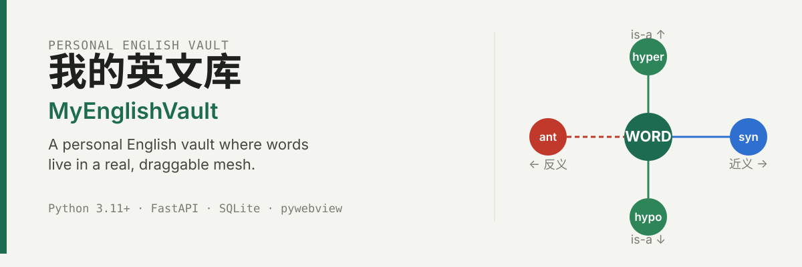
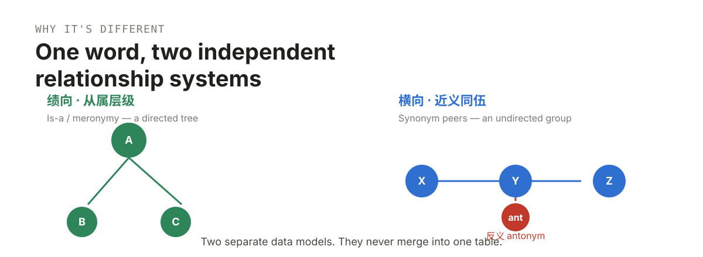
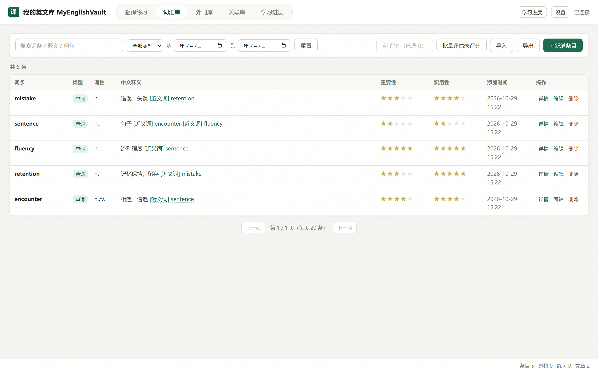
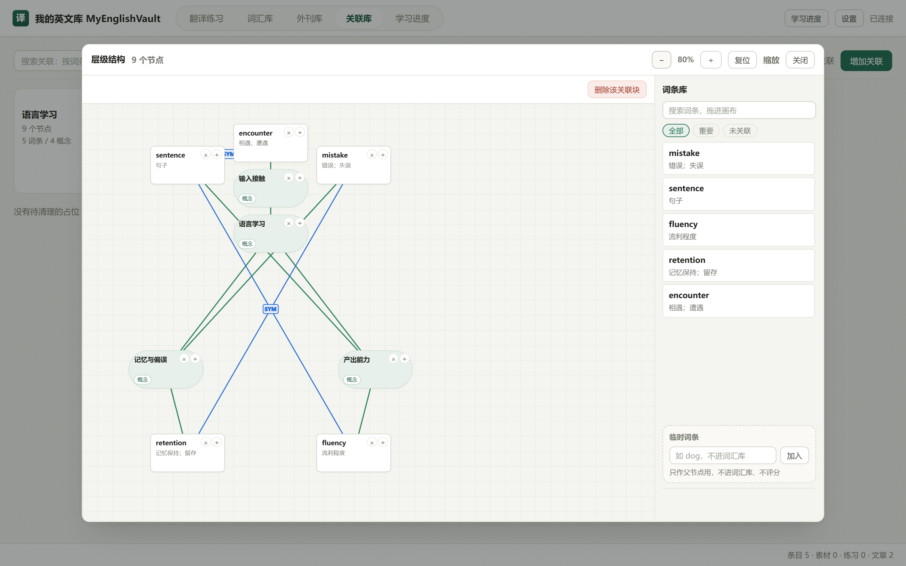
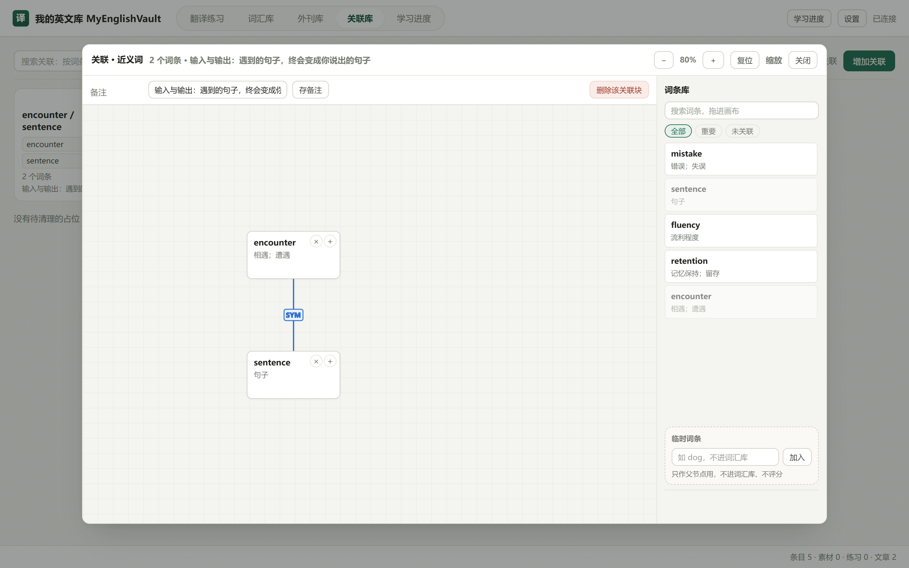
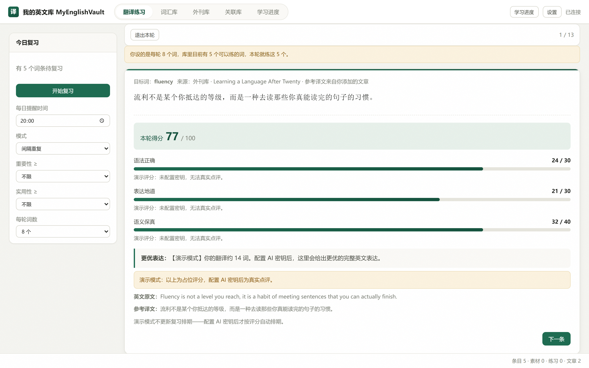
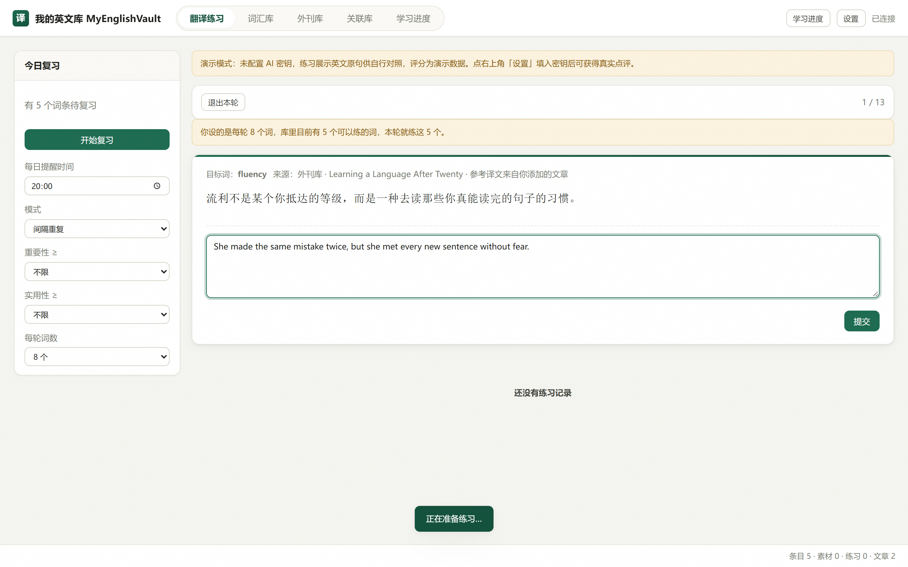
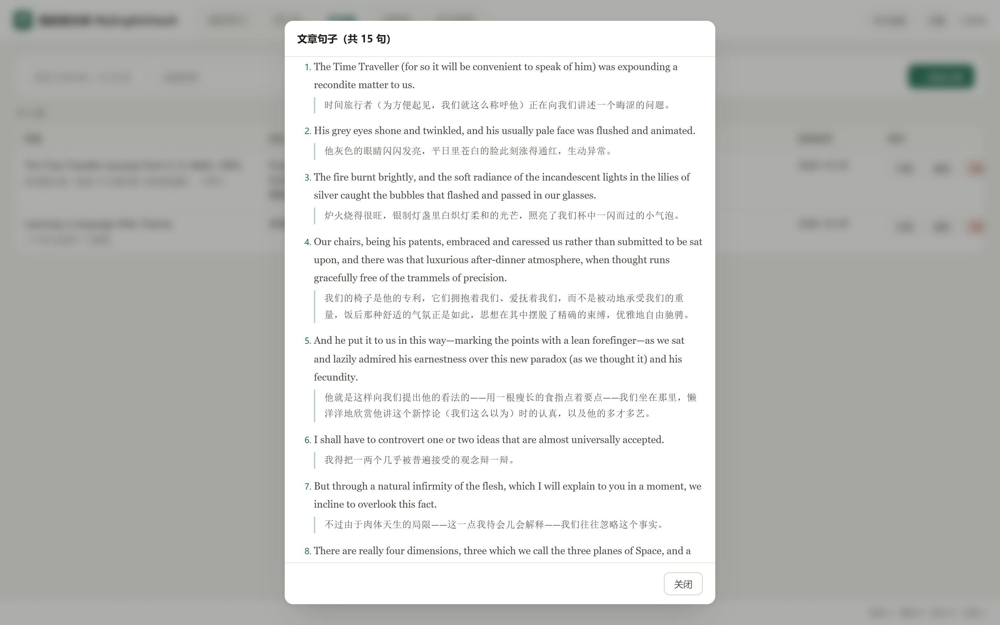
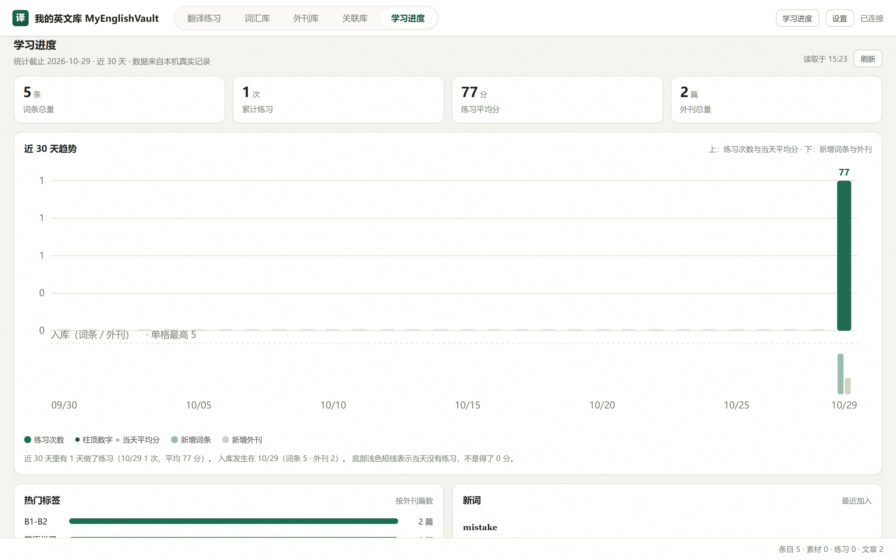

# 我的英文库 · MyEnglishVault

<p align="center">
  
</p>

> A personal English-learning vault where every word lives inside a real, draggable **mesh** of relationships — not a flat list, and not a single tree.

## What it is

MyEnglishVault is a local-first desktop / web app for building a personal English vocabulary. You collect words, paste external articles for reading practice, drill translations, and — most importantly — connect words to each other on a **draggable association canvas**. It runs entirely on your machine: a FastAPI backend, a SQLite file, and a vanilla-JS frontend wrapped in a `pywebview` window (or served as a plain web app).

## Why it's different

Most vocabulary tools force every relationship into one hierarchy — a tree. This project treats a word's **hierarchy** (what it is a kind of, what it is made of) and its **synonym peers** (what it sits beside) as two fundamentally different things, and stores them in **two separate data models that never merge into one table**.

<p align="center">
  
</p>

- **纵向 · 从属层级 (Is-a / meronymy)** — a directed tree. A word can have a parent concept *without* becoming a study entry itself (placeholder nodes).
- **横向 · 近义同伴 (Synonym peers)** — an undirected peer group on the same level.
- **反义 (Antonym)** edges attach orthogonally, on either axis.

The result is a true **network**, not a tree: the same word can be a child in one structure and a peer in another, and the two never conflict.

## Features

| Module | 中文 | What it does |
| --- | --- | --- |
| Translation practice | 翻译练习 | Drill sentences drawn from your reading; self-grade recall, then reveal the reference. |
| Vocabulary | 词汇库 | Your personal word list with meanings, usage, and ratings. |
| Reading | 外刊库 | Paste external articles; they are auto-split into 1:1 sentence pairs for practice. |
| Association canvas | 关联库 | The draggable mesh: build hierarchy and synonym groups visually. |
| Progress | 学习进度 | Analytics on what you have studied and how it is going. |

## Screenshots

<table>
  <tr>
    <td align="center"><br><sub>词汇库 · Vocabulary</sub></td>
    <td align="center"><br><sub>关联库 · Hierarchy</sub></td>
  </tr>
  <tr>
    <td align="center"><br><sub>关联库 · Synonym peers</sub></td>
    <td align="center"><br><sub>翻译练习 · Practice</sub></td>
  </tr>
  <tr>
    <td align="center"><br><sub>翻译练习 · Sentence composition</sub></td>
    <td align="center"><br><sub>外刊库 · Reading</sub></td>
  </tr>
  <tr>
    <td align="center"><br><sub>学习进度 · Progress</sub></td>
    <td align="center"></td>
  </tr>
</table>

## Quick start

### One-click start (recommended)

- **Windows:** double-click **`start.bat`** in this folder. It installs dependencies on first run, then opens the desktop window.
- **macOS / Linux:** from this folder, run **`bash start.sh`**.

Both scripts are idempotent — re-running them just launches the app (the dependency install is fast once cached). Your data is stored locally; nothing is uploaded.

> **Which file do I actually run?** Only **one**: `run.py` (desktop) or `web_server.py` (web).
> The `app/`, `web/`, `tools/`, and `tests/` folders are application code, assets, and the
> automated test suite — **not** programs you open or execute.

### Prerequisites
- Python **3.11+** (developed and tested on 3.13)
- `pip`
- Desktop window: a graphical environment (uses `pywebview`)
- Frontend tests only: Node.js + `jsdom`

### Install
```bash
pip install -r requirements.txt
```
*(`requirements.txt` pins exact, regression-verified versions, so `pip install -r requirements.txt` reproduces the tested environment.)*

### Run — desktop
```bash
python run.py
```
Opens a single `pywebview` window (backend on `127.0.0.1:8765`).

### Run — web
```bash
python web_server.py          # binds 0.0.0.0:8000; set PORT to change
```

### Your data
The app starts with an **empty database**. Add words through the UI — your vocabulary, articles, and practice history are stored locally in a SQLite file, isolated per browser, with no personal information uploaded.

The bundled demo corpus (`app/seed_data.py`) is **self-authored and copyright-clean** (no external-publication text). To load it for development or testing:
```bash
python -m app.seed --db ./demo.sqlite    # refuses to touch your real data
```

## Project layout

**You run exactly one file** — `run.py` (desktop) or `web_server.py` (web).
Everything else is code, tests, or assets. **Do not run** the files inside `app/`,
`web/`, `tools/`, or `tests/` (the last one is the automated test suite).

```
my-english-vault/
├── run.py                 # ★ THE APP — double-click start.bat, or: python run.py
├── web_server.py          # Alternative entry: serves the web/ frontend over HTTP
├── app/                   # Backend (FastAPI): database, vocabulary logic, AI, security
├── web/                   # Frontend: index.html + app.js + style.css — the user interface
├── tools/                 # Developer scripts (seed checker, build fingerprint…) — NOT needed to run
├── tests/                 # Automated test suite (pytest + jsdom) — NOT the app
├── assets/                # Images used by this README (screenshots, diagrams)
├── requirements.txt       # Python dependencies (pinned to tested versions)
├── requirements-web.txt   # Same, for the cloud/web deployment
├── start.bat / start.sh   # One-click launchers (install deps + run the app)
└── LICENSE / README.md
```

## Quality & tests

**1,920 automated assertions, all green** — 1,825 backend checks across 22 test suites plus 95 frontend DOM checks.

```bash
pytest                           # backend
npm install --no-save jsdom     # one-time
node tests/test_frontend_links.js   # frontend DOM regression
```

## Made with

MyEnglishVault is a personal project by **Jack Hever**.

**Stack:** Python 3.11+ · FastAPI · SQLite · uvicorn · pywebview · Vanilla JavaScript

## License
[MIT](./LICENSE) © 2026 Jack Hever
